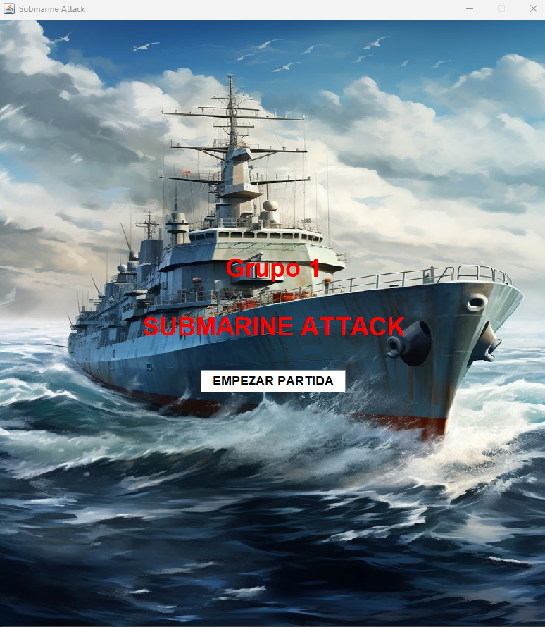
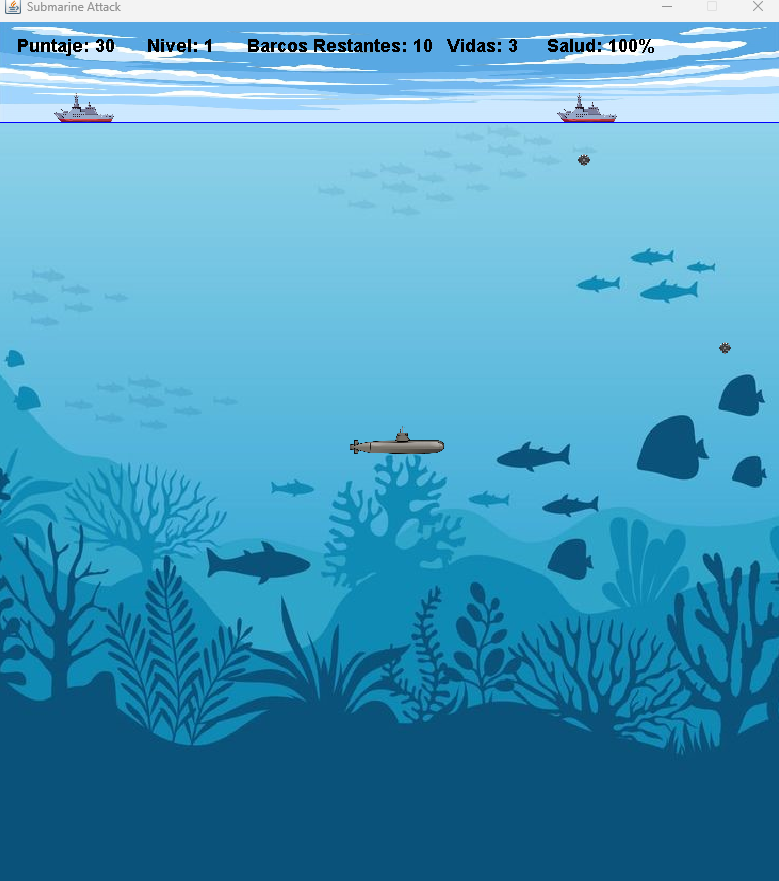

# Submarine Attack

Juego de batalla naval con interfaz gráfica desarrollado en Java (Swing), como proyecto final de la materia de Programación Orientada a Objetos (UADE).

Manejás un submarino que debe esquivar cargas de profundidad mientras hunde barcos enemigos, sumando puntaje y subiendo de nivel.



## Características

- **Interfaz gráfica** hecha con Java Swing (`JFrame`, `JPanel`, `CardLayout` para alternar entre menú y pantalla de juego).
- **Sistema de niveles**: la dificultad y la cantidad de barcos enemigos aumenta a medida que avanzás.
- **Sistema de vidas y salud**: el submarino tiene vidas y un porcentaje de salud que baja al recibir impacto de una carga de profundidad.
- **Audio**: música de fondo y efectos de sonido (explosión, cambio de nivel, pausa, sonar) manejados con la Java Sound API.
- **Pausa** en cualquier momento de la partida.
- **Arquitectura MVC**: separación clara entre `Modelo` (lógica del juego), `Vista` (ventanas y paneles Swing) y `Controlador` (puente entre ambos, implementado como singleton).

## Cómo jugar

Requisitos: JDK 8 o superior.

```bash
git clone https://github.com/MatiasMarrassini/submarine-attack-java.git
cd submarine-attack-java
javac -d out -cp src src/Main.java src/Modelo/*.java src/Vista/*.java src/Controlador/*.java
java -cp out Main
```

> Importante: ejecutá el juego desde la raíz del proyecto (donde está la carpeta `recursos/`), ya que las imágenes y sonidos se cargan con rutas relativas.

También podés abrir la carpeta directamente en IntelliJ IDEA (o cualquier IDE compatible con proyectos Java estándar) y correr `Main.java`.

**Controles:**

| Tecla | Acción |
|-------|--------|
| `W` `A` `S` `D` | Mover el submarino |
| `ESC` | Pausar / reanudar |

## Estructura del proyecto

```
src/
├── Main.java              # Punto de entrada
├── Modelo/                # Lógica del juego (submarino, barcos, cargas de profundidad, niveles)
├── Vista/                 # Ventanas y paneles Swing, manejo de sonido
└── Controlador/           # Controlador singleton, puente entre Vista y Modelo
recursos/                  # Imágenes y audio del juego
```

## Capturas



## Tecnologías

Java (Swing, Java Sound API). Sin dependencias externas.

## Licencia

El código fuente (`src/`) está bajo licencia [MIT](LICENSE).
Las imágenes y sonidos de `recursos/` no son de mi autoría: pertenecen a sus respectivos autores y
se usan solo con fines educativos, por lo que **no** están cubiertos por esa licencia.
